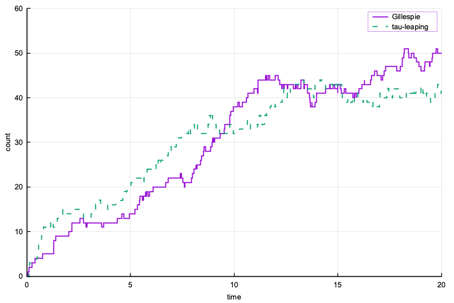
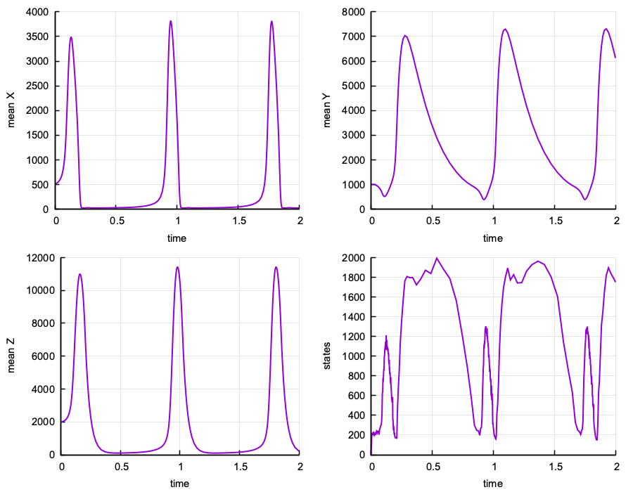

# markovkit

`markovkit` is a C++20 library for continuous-time Markov chains and stochastic reaction
networks, built on `numerics`. It solves the chemical master equation by finite state projection,
simulates paths with the SSA, models reaction-diffusion on meshes, and accelerates simulation by
eliminating subnetworks of states.

Source: [github.com/AdityaDendukuri/markovkit](https://github.com/AdityaDendukuri/markovkit)

## Setup

`markovkit` expects `numerics` in the adjacent directory.

```bash
git clone https://github.com/AdityaDendukuri/numerics.git
git clone https://github.com/AdityaDendukuri/markovkit.git
cd markovkit
cmake -S . -B build -DCMAKE_BUILD_TYPE=Release
cmake --build build -j8
ctest --test-dir build --output-on-failure
```

`#include <markovkit.hpp>` includes FSP, SSA and RDME. `#include <subsweep.hpp>` includes
subnetwork sweeping.

## What it has

| Module | Contents |
| :--- | :--- |
| `cme/` | Reaction systems, finite state spaces, and the generator on a state space |
| `fsp/` | `solve_adaptive_fsp`, flux-controlled state-space growth; `solve_krylov_fsp`, Krylov propagation with the Vo--Sidje mass-loss criterion |
| `ssa/` | `gillespie`, the exact direct method; `tau_leaping`, approximate Poisson leaping |
| `rdme/` | Reaction-diffusion master equation on structured or unstructured voxel meshes, with population multigrid preconditioners for GMRES |
| `subsweep/` | Subnetwork sweeping: eliminate a subnetwork of states, then sample where and when the chain leaves it |

## A first model

A birth-death process, simulated exactly and by tau leaping:

```cpp
#include "markovkit.hpp"

int main() {
    markovkit::reaction_system model;
    model.changes = {{1}, {-1}};
    model.propensities = {
        [](const markovkit::state &, const num::array<double> &r, double) { return r[0]; },
        [](const markovkit::state &x, const num::array<double> &r, double) { return r[1] * x[0]; }};

    const num::array<double> rates = {5.0, 0.1};
    const markovkit::state initial{0};

    const auto exact = ssa::gillespie(model, rates, initial, 0.0, 20.0, 42);
    const auto approximate = ssa::tau_leaping(model, rates, initial, 0.0, 20.0, {}, 42);
}
```



## Subnetwork sweeping

A sweep grows a subnetwork of states around the current state, solves for the distribution of
where and when the chain first leaves it, and jumps there. The linear algebra is chosen by
`sweep_settings::regime`:

| Regime | Factorization |
| :--- | :--- |
| `dense` | Retained inverse, initialized by Cholesky for reversible chains and LU otherwise |
| `block` | Block-tridiagonal LU, reusing the factors of unchanged blocks |
| `block_cholesky` | Block Cholesky with the same reuse, for reversible chains |
| `sparse` | Sparse LU, refactored for each subnetwork |
| `automatic` | `block` when the model supplies levels, `sparse` otherwise |

```cpp
sweep_settings settings{.capacity = 120, .depth = 1, .regime = regime::block};
auto walkers = subsweep_walkers(rate_oracle, initial, walker_count, final_time, settings);
```

## Examples

| Program | Shows |
| :--- | :--- |
| `fsp_oregonator` | Adaptive FSP for the Field--Körös--Noyes oscillator |
| `fsp_toggle_switch` | Adaptive FSP for a bistable genetic switch |
| `ssa_birth_death` | Gillespie SSA against tau leaping |
| `rdme_multigrid_benchmark` | Plain and multigrid-preconditioned RDME GMRES scaling |
| `rdme_two_particle_annihilation` | Reaction-time statistics for diffusing `A + B -> 0` |
| `rdme_multigrid_analysis` | Smoothing and two-grid analysis on fixed-population configuration graphs |


